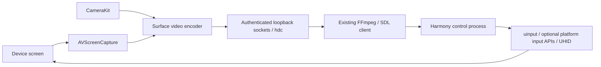

# Harmony implementation notes

scrcpy-harmony is an experimental derivative of upstream scrcpy. The current
supported release targets **rooted arm64 HarmonyOS / OpenHarmony devices** and a
macOS host. Non-root retail-device support has not been validated or released.
See the default [简体中文 README](../README.md) or [English README](../README.en.md) for installation and examples.

## Backends

| Backend | Media | Control | Companion installation |
| --- | --- | --- | --- |
| `--backend=root` | Temporary native process | Native rooted process | None |
| `--backend=agent` (default) | Normal application with system capture prompts | Separate rooted process | Built and installed by the launcher |

For screen mirroring without a companion application:

```sh
./scrcpy-harmony --backend=root --no-audio -w
```

For app-authorized screen or camera capture:

```sh
./scrcpy-harmony --backend=agent --no-audio -w
```

The app-only viewing path is also present when control is disabled. Its startup
boundary is covered by host-side tests, but that does not establish non-root
retail-device compatibility. All published support claims remain root-only.

## Device-side replacement

The Android server uses Java/Dex, adb, Android media encoders, and Android input
services. The Harmony adaptation replaces that device-side execution path:



The desktop client continues to use its existing demuxing, rendering, input
coordinate handling, and recording pipeline. The Harmony launcher handles the
build, device selection, upload, forwarding, process ownership, and cleanup.

## Protocol and lifecycle

- Media packets use the scrcpy 5 protocol, including codec identification, video
  session dimensions, timestamps, and codec-configuration/key-frame flags.
- Encoder output is timestamped with a monotonic clock. Audio encoder timestamps
  that start at zero are aligned to the same origin before transmission.
- Video reset and display-size changes rebuild the capture/encoder session.
- Screen capture requests hide the device cursor so it is not duplicated in
  encoded frames. The desktop cursor remains available for interaction.
  Direct system-overlay mirroring excludes cursor surfaces from its own virtual
  screen, leaving the physical display's cursor and other system panels intact.
  A warning is logged if the firmware does not expose the cursor filter.
- Sockets bind to the device loopback interface. The launcher supplies a random
  session token for every media and control connection.
- The companion ability accepts a one-use private session file written by the
  authorized debugger or root launcher. Arbitrary media arguments are not
  accepted from external ability requests.
- Cleanup releases pressed input, temporary input devices, owned virtual
  displays, session processes, and session-specific hdc forwards.

## Platform adapters

`uinput_backend.h` implements touch and keyboard injection. `native_input.h`
provides optional platform input calls for display-targeted input, hover,
scrolling, and input while the physical panel is off. `hid.h` bridges the
scrcpy UHID control messages to the kernel interface.

`platform.h` handles display power, orientation requests, and virtual-display
lifecycle. Virtual desktop creation requires a system-recognized desktop type
and registration; successful display creation alone does not prove that an
application is visible. A virtual display uses its own dimensions for input.

Some adapters use dynamically resolved internal platform interfaces. Public SDK
compatibility does not guarantee those interfaces or their ABI on every firmware.
Do not treat a successful API return value as proof that an input or system
operation had its intended effect; verify observable behavior on a test device.

## Keyboard text and paste

For the Harmony SDK keyboard, the default text mode forwards committed desktop
IME text instead of mixing letter keys with clipboard-based digit insertion.
The device maps printable ASCII to real key presses, temporarily reconciles
modifiers, and restores held keys afterward. Ordinary text entry, including
numeric/OTP widgets that reject paste, does not require changing the clipboard.
Navigation keys and shortcuts remain key events; an explicit raw-key selection
is preserved. Upstream Android keyboard defaults are unchanged.

Non-ASCII text on the physical main display uses the platform UITest text path.
This may use the clipboard internally. Virtual-display Unicode retains its
targeted paste path because UITest does not expose a display selector; it must
not silently type into the physical screen instead. Explicit paste commands
remain distinct from typing and are subject to application paste restrictions.
Input failures are reported without including the entered text in server logs.

## Capture, signing, and limitations

The native root backend does not install a HAP. Companion capture follows the
system's screen-sharing and runtime camera/microphone authorization prompts.
Capture privacy protection is preserved.

Harmony masks system windows such as notification panels, control centers, and
input methods when system privacy protection is enabled. `AVScreenCapture` may
continue delivering the underlying app/home frame, so a panel visible on the
physical display can be absent from the mirror. The root-only
`--include-system-overlays` option instead mirrors the primary display directly
through ScreenManager. It bypasses system-window masking and can expose notification
or input content; it is disabled by default. This direct path currently requires
`--no-audio`, supports the primary display only, and must not be combined with an
independent virtual display.

The companion build helper can use the development materials supplied with a
compatible SDK. Installation is subject to the device's signing policy. The
helper's bundled-SDK development password is public SDK material, not a user
credential; no private signing material is distributed here. Generated profiles,
certificates, packages, and device-bound configuration stay in ignored build output.

Audio APIs and codecs are implemented, but audible capture is not validated.
Use `--no-audio` for the current supported workflow. Rotation may be overridden by
application policies or sensors. Camera profiles, screen power, virtual displays,
AV1 encoders, and UHID support vary by firmware and hardware.

The current root requirement describes this project's native control backend.
DevEco/HOScrcpy-based non-root development/debugging routes are a future
integration direction, not a shipped backend or a guarantee about retail devices.
No DevEco extension, HOScrcpy binary, or third-party research checkout is bundled.

## Tests

Host-only checks:

```sh
meson setup build-harmony/tests -Dcompile_server=false -Dbuildtype=debug
meson test -C build-harmony/tests --print-errorlogs
python3 -m unittest harmony.test_launch_agent -v
```

Optional checks on an authorized rooted test device:

```sh
python3 harmony/test_protocol.py
python3 harmony/verify_recording.py --seconds 8
```

The protocol test builds and uploads a fixture, checks video sessions and reset,
round-trips text clipboard data, and creates/removes a UHID keyboard. It saves and
restores the clipboard. The recording check saves a local video and checks frame
decoding, duration, and monotonic timestamps. Tests produce local artifacts under
`build-harmony/`; do not include these files in issues or commits without reviewing
and redacting their contents.

## References

- [Upstream scrcpy](https://github.com/Genymobile/scrcpy)
- [Upstream protocol and architecture](develop.md)
- [OpenHarmony native screen capture](https://github.com/openharmony/docs/blob/master/en/application-dev/media/media/avscreencapture-c-basic-process.md)
- [OpenHarmony display APIs](https://github.com/openharmony/docs/blob/master/zh-cn/application-dev/reference/apis-arkui/js-apis-display.md)
- [DevEco Testing](https://developer.huawei.com/consumer/cn/deveco-testing/)
